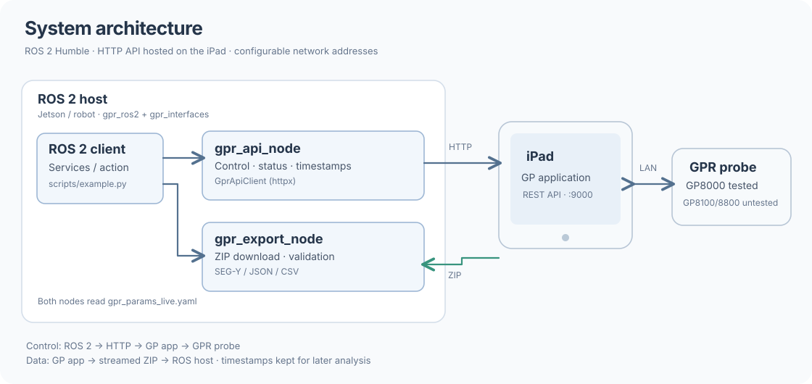

# ROS2-GP-API

**ROS 2 Humble · Ubuntu 22.04 · Python 3.10**  
A lightweight ROS 2 interface for remote control and raw-data acquisition through the Screening Eagle / Proceq **GP API**. The API server runs in the **GP app on an iPad**; the GPR probe connects to the same network.

| GPR device | Validation status |
|---|---|
| **Proceq GP8000** | **Tested** — firmware 5.7.12; TIMED line acquisition and SEG-Y ZIP export verified end-to-end |
| Proceq GP8100 | Not tested |
| Proceq GP8800 | Not tested |

> **Scope:** Research prototype developed for a master's thesis, not a complete implementation of the manufacturer's GP API. The GP8100 and GP8800 are potential targets, **not claimed as compatible or validated**.



## Implemented functionality

The following **GP API endpoints** are wrapped (this is a **subset**, not the complete GP API):

| GP API endpoint | Purpose |
|---|---|
| `GET /screen` | Read app screen/state |
| `GET /probe` | Read probe connection, identity, battery and contract |
| `POST /probe/connect` | Connect to a probe by **serial number and probe IP** |
| `POST /measurement/start` | Create a `LINE_SCAN` measurement |
| `GET /measurement/info` | Read measurement and acquisition settings |
| `POST /measurement/presets` | Configure `TIMED` or `FIXED_STEP` acquisition |
| `POST /measurement/line/start` | Start a line and receive the API start timestamp |
| `GET /measurement/line` | Read line status and scan count |
| `POST /measurement/line/stop` | Stop a line |
| `POST /measurement/export/raw` | Download the raw ZIP archive (SEG-Y + metadata) |
| `POST /measurement/stop` | Finish the measurement |

**Validation limits:** The full ROS 2 workflow was tested with **GP8000 + TIMED (1 Hz)**. `FIXED_STEP` configuration was exercised through the GP API, but a complete FIXED_STEP acquisition was not validated. `EXTERNAL` triggering, pause/resume, live A-scan streaming and other GP API features are **not implemented**.

## ROS 2 interfaces

### Services

| Service | Type | Description |
|---|---|---|
| `/gpr/connect` | `gpr_interfaces/srv/Connect` | Connect the probe (serial number + IP) |
| `/gpr/start_measurement` | `gpr_interfaces/srv/StartMeasurement` | Create a line-scan measurement |
| `/gpr/set_presets` | `gpr_interfaces/srv/SetPresets` | Set trigger mode, frequency and resolution |
| `/gpr/start_line` | `gpr_interfaces/srv/StartLine` | Start recording; obtain API timestamp |
| `/gpr/stop_line` | `std_srvs/srv/Trigger` | Stop recording |
| `/gpr/stop_measurement` | `std_srvs/srv/Trigger` | Finish the measurement |

### Action

| Action | Type | Description |
|---|---|---|
| `/gpr/export_raw` | `gpr_interfaces/action/ExportRaw` | Download, validate and optionally extract the ZIP; report progress |

### Published topics

| Topic | Type | Description |
|---|---|---|
| `/gpr/status` | `gpr_interfaces/msg/GprStatus` | API/probe connectivity, firmware, battery and app status |
| `/gpr/measurement_info` | `gpr_interfaces/msg/GprMeasurementInfo` | Active measurement and presets |
| `/gpr/line_status` | `gpr_interfaces/msg/GprLineStatus` | Line index, scan count, completion state and API-reported length |
| `/gpr/measurement_events` | `gpr_interfaces/msg/GprEvent` | Control events with ROS request/response and available API timestamps |

More details: [ROS interfaces](docs/ros_interfaces.md) · [API mapping](docs/api_reference.md).

## Installation and configuration

**Requirements:** ROS 2 Humble on Ubuntu 22.04, `colcon`, `rclpy`, `httpx` (`python3-httpx`), an iPad running the GP-API-enabled app, a supported network adapter for the probe, and a valid GP API contract. The iPad, probe and ROS 2 host must be mutually reachable on the network. The GP app should remain open/unlocked during acquisition.

Clone the repository as a ROS 2 workspace (the repository root contains `src/`):

```bash
git clone https://github.com/FabianRuefenacht/ROS2-GP-API.git ~/gpr_ros2_ws
cd ~/gpr_ros2_ws
source /opt/ros/humble/setup.bash
colcon build --symlink-install
source install/setup.bash
```

**Create a private, machine-specific configuration before launching:**

```bash
cp src/gpr_ros2/config/gpr_params.yaml src/gpr_ros2/config/gpr_params_live.yaml
```

Edit `gpr_params_live.yaml`: set `ipad_host` in **both node sections** and set `probe_ip` and `probe_serial` under `gpr_api_node`. The two IP addresses are **different**: `ipad_host` points to the iPad's REST server (port 9000 by default), while `probe_ip` points to the GPR antenna. The `Connect` service can also supply probe IP/serial explicitly.

Do **not** commit `gpr_params_live.yaml`; keep it excluded via `.gitignore`. Do not modify tracked `gpr_params.yaml` for site-specific addresses.

Launch both nodes:

```bash
ros2 launch gpr_ros2 gpr.launch.py \
  config_file:="$HOME/gpr_ros2_ws/src/gpr_ros2/config/gpr_params_live.yaml"
```

## Recommended measurement sequence

Execute the following **in order**; **export before stopping the measurement**:

1. `/gpr/connect` — connect and verify the probe.
2. `/gpr/start_measurement` — start `LINE_SCAN`.
3. `/gpr/set_presets` — configure `TIMED` (e.g. 1 Hz).
4. `/gpr/start_line` — begin recording; retain `client_start_timestamp_ms`.
5. `/gpr/stop_line` — end the line; check `/gpr/line_status`.
6. `/gpr/export_raw` — save ZIP, optionally extract SEG-Y/metadata.
7. `/gpr/stop_measurement` — close the measurement **after export**.

For a minimal, runnable walkthrough using only ROS 2 clients, see **[scripts/example.py](scripts/example.py)**. With both nodes already running:

```bash
source ~/gpr_ros2_ws/install/setup.bash
python3 ~/gpr_ros2_ws/scripts/example.py --duration 10 --frequency 1
```

The example uses the probe addresses configured in `gpr_params_live.yaml` and writes to the export directory configured for `gpr_export_node`. Run it only when a probe and the GP app are ready; it **starts a real acquisition**.

## Project notes

- **Architecture:** [docs/architecture.md](docs/architecture.md) and [diagram](docs/architecture.svg)
- **API endpoints and limitations:** [docs/api_reference.md](docs/api_reference.md)
- **Interface reference:** [docs/ros_interfaces.md](docs/ros_interfaces.md)
- **Validation:** [docs/testing.md](docs/testing.md)

**Caveats:** Synchronous API calls can block ROS callbacks. The API-reported line length is not robot odometry. ROS timestamps and the API-provided Unix-millisecond start timestamp are not automatically synchronized. After locking the iPad, HTTP timeouts were observed. Other GP API functions and devices require separate validation.

**License:** MIT. This repository does not redistribute the manufacturer's API documentation, firmware or proprietary application.
