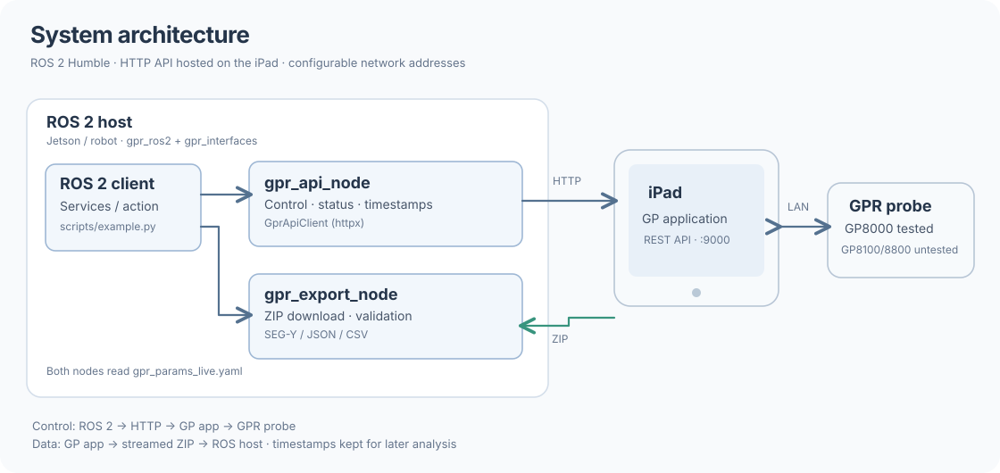

# Architecture

The implementation contains two ROS 2 packages:

- **`gpr_interfaces`** (`ament_cmake`): custom messages, services and the raw-export action.
- **`gpr_ros2`** (`ament_python`): independent `GprApiClient` (`httpx`), `gpr_api_node` for control/status, and `gpr_export_node` for ZIP download and optional extraction.

## Data and control flow

1. A ROS 2 client calls `/gpr/connect`, measurement services or `/gpr/export_raw`.
2. The corresponding node sends HTTP requests to the **GP API hosted on the iPad**.
3. The iPad GP app communicates with the **GPR probe** over the local network. Both the iPad IP and the probe IP are needed for connection setup; the probe serial number identifies the target device.
4. The API node publishes status and measurement events; the export node saves the binary ZIP and can extract SEG-Y/JSON/CSV files.

Both nodes load `gpr_params_live.yaml`. The IP addresses and probe serial number are intentionally **not hardcoded** in Python code. The default API port is configurable (normally `9000`).

## Timing

`/gpr/measurement_events` contains ROS request/response times and the API's `clientStartTimestamp` (Unix milliseconds) where available. These are **different clocks** unless separately synchronized. The exported SEG-Y and associated metadata are preserved for subsequent thesis-specific analysis; this package does not georeference the traces.

## Operational limitations

The HTTP control node uses synchronous requests and a single-threaded executor; lengthy operations can delay callbacks. The export action runs in a separate ROS node. This is a thesis research implementation, not a real-time or production-ready acquisition platform.
